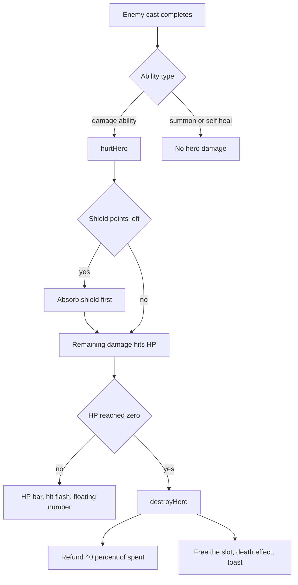

# Hero HP & Combat Balance Plan

## Goal

Make heroines real combat units: they have HP, take damage from mobs and bosses, can be healed or shielded, and die permanently (40% refund) if their HP reaches 0. Add clear UI feedback and rebalance the economy/difficulty around the new damage source. Also loop the Monster High instrumental on the game screen.

## Background music

- Add `<audio id="bgm" src="./assets/audio/monster-high-instrumental.mp3" loop preload="auto"></audio>` to [`index.html`](index.html).
- Replace the note-timer in [`startMusic()`](app.js:1426) with playback of this track, `loop = true`, volume around `0.45`.
- Start playback from the first user gesture: [`startMap()`](app.js:340) when the game screen opens, so autoplay restrictions are satisfied.
- Keep the track looping for the whole game screen, including the pause overlay.
- Pause the track when leaving the game screen, and resume when the player returns; keep the existing `musicOn` toggle working as pause/resume.
- If the file is missing or playback is rejected, fall back to the existing synthesized loop so the game is never silent.
- Do not add the mp3 to the `CORE` precache in [`sw.js`](sw.js:2): the runtime fetch handler caches same-origin requests, and a missing file would make `addAll` fail and break the service worker install.
- Bump the cache key from `ghouls-siege-v6` to `ghouls-siege-v7`.

## Current state

- [`HEROES`](app.js:5) only defines `cost`, `damage`, `range`, `rate`; there is no HP.
- [`placeHero()`](app.js:513) creates a tower object without HP, shield, or death state.
- [`mobCast()`](app.js:636) plays a visual attack and only adds a hit effect; no HP is changed.
- [`bossCast()`](app.js:649) at most sets `target.flinch = 1.6` (delays the hero's next attack).
- Lives are lost only when an enemy reaches the end of the path ([`update()`](app.js:1060)).
- Difficulty only scales enemy HP ([`addEnemy()`](app.js:595), [`spawnBoss()`](app.js:569)).
- [`mobs/bestiary.js`](mobs/bestiary.js:1282) already contains per-monster `damage` values (`frog: 5` ... `bloodQueen: 145`), so no new enemy data is required.

## Damage pipeline



### Damage formula

```
mobDamage   = bestiary.damage * DIFF[difficulty].dmg * waveScale
bossDamage  = bestiary.damage * BOSS_DMG_MULT * DIFF[difficulty].dmg * waveScale
waveScale   = 1 + wave * 0.03 + max(0, wave - 8) * 0.012
finalDamage = min(damage, target.maxHp * 0.5)
```

- `BOSS_DMG_MULT = 0.45`
- The 50% per-hit cap prevents one-shots from a single boss cast and keeps HP upgrades meaningful.
- Mob attack cooldown grows slightly from `3.2–6.0s` to `3.6–6.4s`.
- Boss cast interval stays `4.5–7s`, but repeated targeting of the same hero is forbidden.

### Difficulty table

| Difficulty | Enemy HP | Enemy damage | Rewards |
|---|---|---|---|
| easy | 0.75 | 0.70 | 0.90 |
| normal | 1.00 | 1.00 | 1.00 |
| hard | 1.50 | 1.25 | 1.30 |

Replace the inline ternaries in [`addEnemy()`](app.js:595) and [`spawnBoss()`](app.js:569) with a single `DIFFICULTY` config object.

## Hero HP values

| Hero | Role | HP | Damage | Range | Rate |
|---|---|---|---|---|---|
| Draculaura | burst damage | 160 | 34 | 145 | 1.15 |
| Lagoona | control | 190 | 15 | 155 | 1.00 |
| Clawdeen | area damage | 200 | 24 | 130 | 1.35 |
| Frankie | support | 220 | 18 | 150 | 1.10 |
| Kiyomi | long range | 150 | 23 | 180 | 1.00 |
| Bonita | support | 185 | 8 | 120 | 1.50 |
| Catty | area damage | 175 | 19 | 150 | 1.20 |
| Rochelle | control tank | 240 | 12 | 135 | 1.30 |
| Abbey | control | 215 | 21 | 155 | 1.10 |
| Spectra | debuff | 155 | 17 | 190 | 1.25 |

Selected damage check on normal, wave 8 (`waveScale = 1.246`):

| Enemy | Raw damage | Damage to hero | Hits to kill a 150 HP hero |
|---|---|---|---|
| frog | 5 | 6 | 25 |
| zombie | 12 | 15 | 10 |
| ghost | 32 | 40 | 4 |
| golem | 40 | 50 | 3 |
| darkMage | 48 | 60 | 3 |
| final boss | 145 | 81 | 2 |

## Mechanics

### Hero object additions

In [`placeHero()`](app.js:513) add:

```
maxHp, hp, dead, hitFlash, shield, shieldUntil, lastHitUid, incoming
```

### Taking damage

Add `hurtHero(t, dmg, source)`:

1. Ignore dead heroes.
2. Absorb `t.shield` first.
3. Subtract remaining HP.
4. Set `t.hitFlash = 0.22`, add a hit effect and a floating damage number.
5. If HP reaches 0, call `killHero(t)`.

### Permanent death

`killHero(t)`:

- `t.dead = true`, remove after the current update loop.
- Refund `Math.floor(t.spent * 0.4)` BIT$.
- Clear selection if this hero was selected.
- Add a dark-pink death burst and a field shake class.
- Play a low death tone and show a toast with the refund amount.
- Do not remove a life: the base only loses lives when enemies reach the end.

### Healing sources

| Source | Effect | Cost |
|---|---|---|
| Inspector heal button | Restore to full HP | `ceil(missingHp * 0.30)`, minimum 5 BIT$ |
| Wave clear | Surviving heroes regenerate 12% max HP | free |
| Bonita special | 35% max HP shield to allies within 220 px for 8 s | cooldown 24 s |
| Frankie special | +15% damage buff plus 12% max HP instant heal to all heroes | cooldown 24 s |
| Orb `💊 Лечение` | All heroes heal 35% max HP | 70 BIT$ |
| Orb `🛡 Эгида` | All heroes gain 50 shield for 15 s | 70 BIT$ |

Bonita's existing shield visual should target actual allies; the shield pool must absorb damage before HP.

### Upgrade changes

Keep three existing upgrades and add a fourth `health` card so the 2-column [`#upgrade-grid`](styles.css:99) shows a clean 2x2 layout.

| Upgrade | Effect per level | Cost |
|---|---|---|
| damage | +35% damage | 65 + 45 * level |
| speed | +15% attack speed | 65 + 45 * level |
| range | +12% range | 65 + 45 * level |
| health | +18% max HP and heal the added amount | 65 + 45 * level |

Maximum 3 levels each, same as now.

## UI and feedback

- **Canvas HP bar** above every damaged or selected heroine, `44x5 px`, green above 60%, amber 30–60%, red below 30%.
- **Shield bar** as a thin cyan strip above the HP bar when `t.shield > 0`.
- **Floating damage numbers** in a new `state.floaters` array, updated in [`update()`](app.js:960) and drawn in [`draw()`](app.js:1166).
- **Hit flash** around the sprite plus a short sprite shake while `hitFlash > 0`.
- **Death effect**: expanding ring and skull glyph in the effects pass.
- **Inspector HP block** between the description and stats:
  - `ЗДОРОВЬЕ 90/90`
  - fill bar with the same green/amber/red thresholds
  - heal button with dynamic cost and disabled state at full HP
- **HUD chip** `В СТРОЮ` showing the number of living heroines, added after the lives chip in [battle HUD](index.html:128).
- **Shop orb cards** get two new entries; the existing scroll container handles the extra width.
- **Mobile CSS** for the HP bar, heal button, and extra HUD chip at the existing `760px / 480px` breakpoints.

## Targeting and safety rules

- [`nearestHero()`](app.js:626) must skip heroes with `dead === true`.
- Mobs choose the nearest living heroine; at cast time the target is stored. On hit, if that heroine died mid-cast, redirect to the nearest living heroine within range.
- Boss targeting excludes the previous target and filters dead heroes.
- Boss abilities with `at: 'self'` (heal) and `at: 'front'` (summon) deal no hero damage.
- Add a per-hero 0.15 s damage grace window so a single frame cannot stack several hits; excess hits are merged.

## Economy balance

| Change | Before | After |
|---|---|---|
| Coins per regular kill | 5 | 7 |
| Wave clear bonus | 25 + wave * 4 | 35 + wave * 5 |
| Boss kill | 250 | 250 |
| Map completion | 250 | 250 |
| Death refund | none | 40% of spent |
| Sell refund | 65% of spent | unchanged |

Repair costs do not increase `t.spent`, so death refunds and sell values remain based on build and upgrade investment only.

## Files to change

- [`app.js`](app.js) — hero HP data, difficulty config, damage pipeline, death/heal/shield logic, targeting, orbs, rewards, canvas and inspector rendering, and looping background music.
- [`index.html`](index.html) — inspector HP block, heal button, `В СТРОЮ` HUD chip, and the `#bgm` audio element.
- [`styles.css`](styles.css) — HP bars, heal button, actions row, death shake, mobile rules.
- [`sw.js`](sw.js) — bump cache version, keep audio out of precache.
- [`README.md`](README.md) — document the HP system, healing, death refund, new balance, and the looping track.
- [`assets/audio/monster-high-instrumental.mp3`](assets/audio) — user-provided track, must exist for music playback.
- [`mobs/bestiary.js`](mobs/bestiary.js) — no edits required; its `damage` values are reused as the damage base.

## Acceptance checklist

- Heroines display HP and lose HP from mob and boss damaging abilities.
- Shields absorb damage before HP and are visible in the inspector and above the sprite.
- A heroine at 0 HP is removed permanently, frees the slot, and refunds 40% of spent BIT$.
- All heroes survive with correct HP after selling, upgrading, restarting a map, and completing a wave.
- Difficulty changes both enemy HP and enemy damage.
- Healing works from the inspector, wave clear, Bonita, Frankie, and both new orbs.
- No one-shot damage exceeds 50% of a heroine's max HP per hit.
- HP bars, floating numbers, hit flash, death effect, HUD counter, and mobile layout render correctly.
- The Monster High instrumental loops for the whole game screen, pauses on leaving, resumes on return, survives the music toggle, and falls back to the synth loop when the file is unavailable.
- README and service worker cache version are updated.
